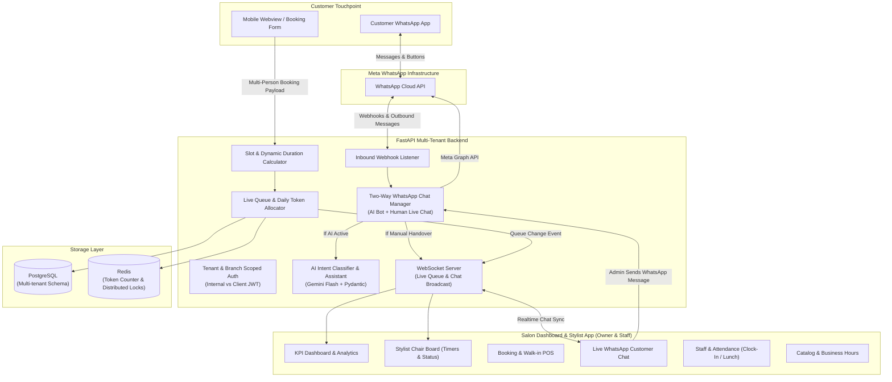
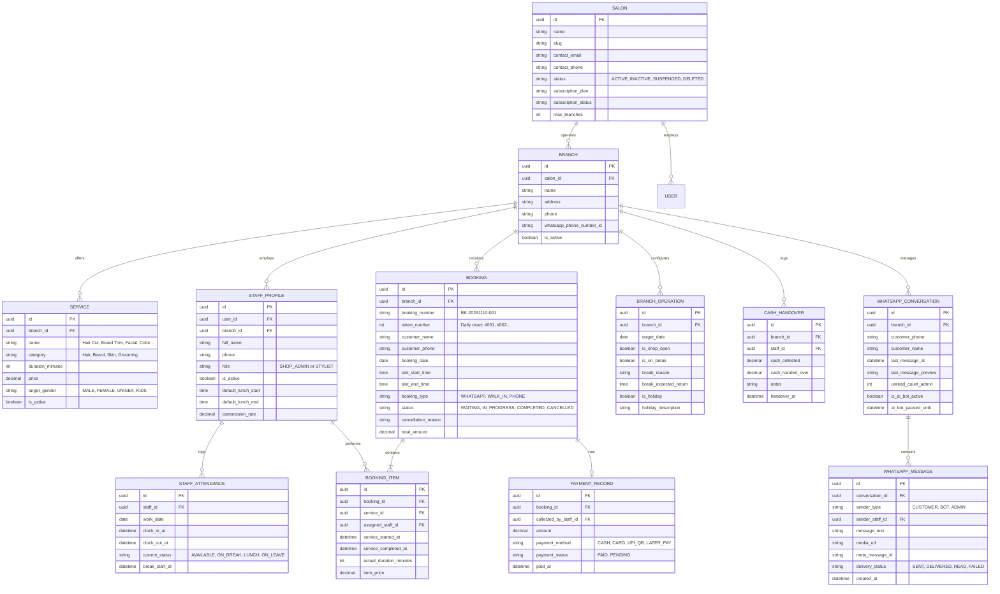
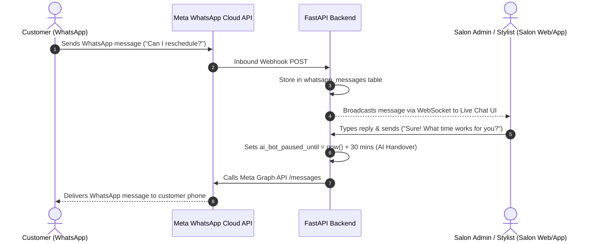
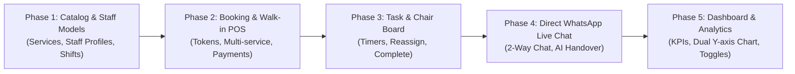

# Hair Salon AI Platform — Technical Architecture & Implementation Plan

A comprehensive technical blueprint and implementation roadmap for building a **multi-tenant WhatsApp AI booking, live queue management, stylist task board, direct customer messaging, and salon operations platform**.

---

## 1. System Architecture Overview

---

## 2. Complete Database Schema (Core + Client + Messaging)

---

## 3. Client Modules & REST API Specifications

All routes below require the **Client Bearer Token** (`Depends(get_current_client_user)`). The user's `branch_id` and `salon_id` are automatically extracted from the JWT token.

---

### Module 1: Dashboard & Analytics

#### Responsibilities:
1. **Real-time Today's KPIs**:
   - `today_queue`: Customers waiting for hair cuts right now.
   - `total_bookings_today`: Total scheduled + walk-ins today.
   - `total_revenue_today`: Sum of all `PAID` bills collected today.
   - `total_completed_today`: Total finished haircuts today.
   - `staff_availability`: E.g., `2/3 available` (staff who are clocked-in and not on break/lunch).
2. **Shop Controls**:
   - One-tap Open / Close shop toggle.
   - Break mode (e.g. 30m break, pauses automatic WhatsApp slot booking).
   - Set holiday for today or upcoming dates.
3. **Upcoming Queue List**:
   - Next 5 upcoming appointments sorted by time and token number.
4. **Dual Y-Axis Line Chart**:
   - Left Y-Axis: Revenue amount.
   - Right Y-Axis: Booking count.
   - Timeframe filter: `7_days`, `14_days`, `1_month`, `1_year`, `all`.
   - Comparison with previous period and moving-average forecast.

#### Endpoints:
| Method | Path | Description |
| :--- | :--- | :--- |
| `GET` | `/api/v1/client/dashboard/stats/today` | Real-time KPIs (Queue, Bookings, Revenue, Completed, Staff) |
| `GET` | `/api/v1/client/dashboard/upcoming-queue` | Next 5 upcoming customers with token & booking ID |
| `GET` | `/api/v1/client/dashboard/analytics/revenue-chart` | Dual-axis line graph data with timeframe filters |
| `POST` | `/api/v1/client/dashboard/operations/toggle-open` | Toggle shop open/close state |
| `POST` | `/api/v1/client/dashboard/operations/break` | Set temporary shop break with return time |
| `POST` | `/api/v1/client/dashboard/operations/holiday` | Set holiday for today or specific date |

---

### Module 2: Stylist Task & Chair Workflow

#### Responsibilities:
1. **Role-Based Chair Board**:
   - Stylist login: Sees their personal queue of assigned customers.
   - Admin login: Sees chairs for all stylists with live status (`WAITING`, `IN_PROGRESS`, `COMPLETED`).
   - If Admin cuts hair: Admin can filter and pick their own chair.
2. **Chair Timer & Execution**:
   - Stylist taps **"Start Service"** -> records start time (status: `IN_PROGRESS`).
   - Stylist taps **"Complete"** -> records duration and triggers payment collection modal.
   - Stylist/Admin taps **"Drop / Cancel"** -> selects reason (*Customer left, No-show, Emergency*).
3. **Payment Collection**:
   - Payment modes: `CASH`, `UPI_QR`, `CARD`, `LATER_PAY`.
   - Updates payment status to `PAID` or `PENDING`.
4. **Reassign & Reschedule**:
   - Admin can drag/reassign a customer to another stylist.
   - Admin can change slot time if appointments are delayed.

#### Endpoints:
| Method | Path | Description |
| :--- | :--- | :--- |
| `GET` | `/api/v1/client/tasks/board` | Live chair board (auto-filtered if stylist) |
| `POST` | `/api/v1/client/tasks/{booking_item_id}/start` | Start cutting hair (starts timer) |
| `POST` | `/api/v1/client/tasks/{booking_item_id}/complete` | Finish haircut & prompt payment |
| `POST` | `/api/v1/client/tasks/{booking_id}/cancel` | Cancel task with reason |
| `POST` | `/api/v1/client/tasks/{booking_id}/collect-payment`| Record payment mode & amount |
| `PATCH` | `/api/v1/client/tasks/{booking_item_id}/reassign` | Reassign task to another stylist |
| `PATCH` | `/api/v1/client/tasks/{booking_id}/reschedule` | Move customer to another time slot |

---

### Module 3: Booking & Walk-in POS Module

#### Responsibilities:
1. **Master Booking List**:
   - Filterable list of all orders (Token #, Name, Phone, Services, Stylists, Total Amount, Payment Status, Status).
2. **Manual Walk-In Creation**:
   - Admin inputs customer name + phone.
   - Selects multiple services (Haircut + Shave + Facial).
   - Selects specific stylist or auto-assigns to the least-busy stylist.
   - Generates daily sequential **Token Number** (e.g. `#015`).
   - Sends automated WhatsApp token notification to customer.

#### Endpoints:
| Method | Path | Description |
| :--- | :--- | :--- |
| `GET` | `/api/v1/client/bookings` | Filterable list of all bookings |
| `GET` | `/api/v1/client/bookings/{id}` | Detailed booking view with service items |
| `POST` | `/api/v1/client/bookings/walk-in` | Create instant walk-in booking & issue token |
| `POST` | `/api/v1/client/bookings/{id}/send-reminder`| Send manual WhatsApp arrival alert |

---

### Module 4: Direct WhatsApp Customer Messaging (Two-Way Live Chat)

#### Responsibilities:
1. **Direct Two-Way Messaging Inbox**:
   - Salon Admin can chat directly with any customer on WhatsApp from within the salon web dashboard or mobile app.
   - Real-time message exchange powered by FastAPI WebSockets.
2. **Conversation Thread Management**:
   - Thread list shows: Customer name, phone number, last message snippet, timestamp, unread counter.
   - Ability to search by customer name or phone number.
   - **Click-to-chat** shortcut directly from any Booking or Queue card.
3. **AI Handover & Pause Bot Control**:
   - When Admin manually replies, the system **pauses the AI bot** for that conversation for 30 minutes so the bot doesn't send automated replies while the human admin is talking.
   - Toggle button: `[ Resume AI Bot ]` / `[ Pause AI Bot ]` available in the chat header.
4. **Canned Quick Responses (Snippets)**:
   - ⚡ *"Your chair is ready! Please proceed inside."*
   - ⚡ *"We are running approximately 15 minutes behind schedule. Thank you for your patience!"*
   - ⚡ *"Please share a reference photo of the hairstyle you would like."*
   - ⚡ *"Here is our Google Maps location: [Link]"*

#### Endpoints:
| Method | Path | Description |
| :--- | :--- | :--- |
| `GET` | `/api/v1/client/messages/conversations` | List all WhatsApp conversation threads |
| `GET` | `/api/v1/client/messages/conversations/{id}` | Get chat message history with customer |
| `POST` | `/api/v1/client/messages/send` | Send direct WhatsApp message to customer |
| `POST` | `/api/v1/client/messages/conversations/{id}/toggle-ai`| Pause or resume AI bot for this customer |
| `GET` | `/api/v1/client/messages/canned-responses` | Get quick reply templates |
| `POST` | `/api/v1/client/messages/canned-responses` | Create custom canned response |
| `WS` | `/ws/client/messages` | WebSocket for real-time inbound & outbound chat |

---

### Module 5: Staff Management, Attendance & Cash Handover

#### Responsibilities:
1. **Staff Profiles (CRUD)**:
   - Create stylist accounts, define phone, default lunch start/end, and active status.
2. **Attendance & Shift Lifecycle**:
   - Stylist logs in -> taps **"Clock In"**.
   - Taps **"Lunch Break"** -> status becomes `LUNCH` (blocks new bookings during lunch).
   - Taps **"Resume Work"** -> status becomes `AVAILABLE`.
   - Taps **"Clock Out"** at end of day.
3. **Cash Handover Tracking**:
   - Stylist dashboard shows: Total cash collected by this stylist today.
   - Stylist hands over collected cash to Store Owner/Cash Register -> records handover entry with notes.

#### Endpoints:
| Method | Path | Description |
| :--- | :--- | :--- |
| `GET` | `/api/v1/client/staff` | List all staff members and their live statuses |
| `POST` | `/api/v1/client/staff` | Create new stylist profile (Admin only) |
| `PUT` | `/api/v1/client/staff/{id}` | Update stylist profile or lunch time |
| `DELETE` | `/api/v1/client/staff/{id}` | Deactivate stylist profile |
| `POST` | `/api/v1/client/staff/attendance/clock-in` | Clock in for today's shift |
| `POST` | `/api/v1/client/staff/attendance/break` | Start lunch or short break |
| `POST` | `/api/v1/client/staff/attendance/resume` | End break & resume availability |
| `POST` | `/api/v1/client/staff/attendance/clock-out` | Clock out shift |
| `POST` | `/api/v1/client/staff/cash-handover` | Log cash handover to salon owner |
| `GET` | `/api/v1/client/staff/my-summary` | Current stylist's personal earnings & tasks |

---

### Module 6: Catalog & Business Schedule

#### Responsibilities:
1. **Services Catalog (CRUD)**:
   - Haircut, Beard Trim, Shave, Facial, Hair Color, Foundation, etc.
   - Service category, standard duration in minutes, price, and target category (Male, Female, Unisex, Kids).
2. **Operating Hours**:
   - Salon opening and closing time (e.g. 09:00 AM – 09:00 PM).
   - Slot interval step (e.g. 15m or 30m).
   - Regular weekly off days (e.g. Every Monday).

#### Endpoints:
| Method | Path | Description |
| :--- | :--- | :--- |
| `GET` | `/api/v1/client/catalog/services` | List all salon services |
| `POST` | `/api/v1/client/catalog/services` | Add new service |
| `PUT` | `/api/v1/client/catalog/services/{id}` | Update service price/duration |
| `DELETE` | `/api/v1/client/catalog/services/{id}` | Deactivate service |
| `GET` | `/api/v1/client/catalog/business-hours` | Get branch operating hours |
| `PUT` | `/api/v1/client/catalog/business-hours` | Update branch operating hours |

---

## 4. Operational Enhancements Summary

1. **Daily Resetting Token Sequence (`#001`, `#002`)**: Simple, readable token numbers for customer queues.
2. **Automated WhatsApp Chair Alert**: When Token #4 sits in chair, WhatsApp automatically notifies Token #5 and #6: *"You are next in line! Please arrive in 10 minutes."*
3. **AI Handover Protection**: When Admin speaks to a customer manually in Live Chat, the AI bot pauses automatically for 30 minutes to prevent conflicting messages.
4. **End-of-Day Cash Handover Reconciliation**: Automatically matches recorded cash task earnings against physical cash turned in by each stylist.
5. **Multi-Person Concurrent Scheduling**: Automatically stacks durations for multiple services or splits them across available stylists concurrently.

---

## 5. Development Roadmap (Phased Order)

